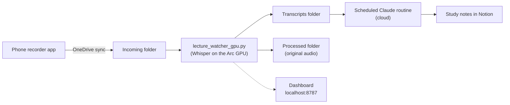

# Lecture Whisper

Record a lecture on your phone and put the phone away. By the time you're back at your laptop, a timestamped transcript is waiting, and study notes for it are on their way to Notion.

Lecture Whisper is a hands-off pipeline for Windows that watches a OneDrive folder for new recordings and transcribes them **locally on an Intel Arc integrated GPU** with OpenAI's Whisper (large-v3) through OpenVINO. Along the way it strips out silence, feeds Whisper vocabulary specific to each course, catches and repairs Whisper's typical failure modes, keeps the laptop awake (even with the lid closed) until the job is done, and makes any failure impossible to miss. A small local dashboard shows what it's doing right now and every lecture it has transcribed so far.



## Contents

- [How a recording flows through](#how-a-recording-flows-through)
- [Features](#features)
- [Performance](#performance)
- [Project layout](#project-layout)
- [Setup](#setup)
- [Operating tips](#operating-tips)
- [Privacy](#privacy)

## How a recording flows through

1. **A recording lands** in the watched OneDrive folder. The watcher sees it right away, or picks it up during the catch-up scan the next time it starts.
2. **It waits for OneDrive to finish syncing.** The file has to keep the same non-zero size for three checks in a row before it's touched, so a half-synced file or a cloud-only placeholder is never processed.
3. **ffmpeg converts it** to 16 kHz mono 16-bit WAV in a scratch folder outside OneDrive.
4. **Silero VAD strips the silence**, so Whisper only spends time on actual speech.
5. **Whisper large-v3 transcribes it on the GPU**, steered by that course's hotwords.
6. **A repair pass** finds stretches where Whisper looped or skipped speech and re-transcribes just those spans.
7. **Timestamps are mapped back** to the original recording's timeline, and the transcript is written as `<recording name>_<YYYYMMDD_HHMM>.txt`.
8. **The original audio moves** to the Processed folder, and the run is added to the dashboard's history.
9. **Study notes get made.** A scheduled Claude routine picks the transcript up from OneDrive and writes notes into Notion (or the built-in notes step does it right away).

Each transcript line looks like this:

```
[754.32s -> 760.18s]  So the demand curve shifts out, but the quantity supplied moves along the curve.
```

## Features

### Transcription that runs on the laptop's GPU

- **Whisper on the Intel Arc iGPU.** Runs through [OpenVINO GenAI](https://github.com/openvinotoolkit/openvino.genai) with int8 versions of `whisper-large-v3` (the default, for accuracy) and `whisper-large-v3-turbo` (for speed). The models load from local disk, so no network access is needed to transcribe.
- **Silence stripping with timestamps that still line up.** Silero VAD (the same ONNX model and settings faster-whisper uses for `vad_filter`) cuts dead air before transcription. Every segment's timestamps are then mapped back to where it actually happened in the original recording.
- **Per-course hotwords.** Each course has its own list of vocabulary that is fed to Whisper as context for every 30-second window, which nudges it toward the right spellings. The lists are built from words Whisper actually got wrong in real lectures, such as "tutology" for *tautology*, "fantasy store" for *transistor*, and "setterist paradox" for *ceteris paribus*. Each list is kept under a measured token budget so it never crowds out the transcript itself.
- **Course detection from the filename.** Recordings are matched to a course by flexible filename aliases, so "Micro sept 24", "ECON101 review", and "econ midterm" can all map to the same course. An alias starting with `^` only matches at the start of the name, so `^art` catches "Art history.m4a" but not "Smart phones.m4a".

### Self-repairing transcripts

Whisper has two well-known ways of going wrong on long recordings, and the watcher checks every segment for both:

- **Runaway loops.** Whisper gets stuck repeating itself ("yeah yeah yeah..." hundreds of times) and never closes the segment. These are detected by a broken end timestamp or a zlib compression ratio above 3.0. The threshold is calibrated on real lectures: a class reading binary digits aloud scores up to 2.46, while real loops scored 28.9 and 71.6, so the usual 2.4 cutoff would have flagged legitimate speech.
- **Skipped passages.** Whisper writes a scrap like "Thank you." and jumps to the end of the window, silently dropping the speech in between. This is detected as a segment at least 15 seconds long with fewer than 0.5 words per second (normal speech is 2 to 3).

Each flagged span is re-transcribed through a ladder of different model and prompt combinations, ordered by what actually fixed real failures in testing. A retry only replaces the original if it is clearly better: it must not loop itself, and for a skip it has to recover at least twice as many words and at least 10 more. A loop that never closed and that no retry can fix is dropped, because a short gap is better than 444 copies of "yeah".

### Switch models mid-lecture

If a long recording is taking a while, one click on the dashboard switches it to large-v3-turbo **without losing any work**. Large-v3 stops at the end of its current 30-second window, everything it finished is kept, and turbo transcribes only the rest. To make the seam clean, turbo gets the last few segments of large-v3's text as its prompt (without that, it tended to drop a clipped first word and lose the punctuation style). The request names the specific recording, so it can never carry over to a later file, and the history records exactly which models were used (for example `large-v3 -> large-v3-turbo`).

### Hands-off automation

- **Starts at logon** through Task Scheduler and runs indefinitely with no console window.
- **Catches up on startup.** Anything that arrived while the laptop was off or asleep is processed before live watching begins.
- **Close to zero idle footprint.** The model only loads when a recording shows up, and GPU memory is released as soon as each lecture is done.
- **Works on battery.** The scheduled tasks are set up so they start on battery and are never killed when the laptop is unplugged, which is how a laptop usually is during a lecture.

### Keeps the laptop awake while it works, even with the lid closed

Closing the lid in the middle of a transcription would normally put the laptop into standby and freeze the job until it's opened again. While a recording is processing, `keep_awake.py`:

- holds a `SetThreadExecutionState` request so the idle timer can't put the machine to sleep, and
- temporarily sets the active power plan's "When I close the lid" action to **Do nothing** (plugged in and on battery), then puts the original values back.

Closing the lid mid-run just turns the screen off. The laptop sleeps normally through its usual idle timer once the job is done.

This is built to be crash-safe. The original lid settings are saved to a backup file **before** anything changes, and they're restored at the end of every recording, before every failure exit, and again whenever the watcher starts. A crash or a killed process is repaired automatically the next time it launches. No admin rights are needed.

### Fails loudly, never silently

A background process with no console can fail without anyone noticing, so this one is designed to make that impossible:

- **GPU check at startup.** If OpenVINO can't see the GPU, the watcher stops with an explanation instead of quietly falling back to a much slower CPU path.
- **On any failure** (GPU, ffmpeg, a bad `config.json`, or anything else), it logs the full traceback, shows a Windows toast notification, **always** writes a `FAILED - <name>.txt` marker file to the Desktop and Downloads (toasts aren't guaranteed to reach a headless process, but marker files are), and then exits. It deliberately doesn't skip the recording and carry on, because a broken GPU would just fail every file after it, one silent failure at a time.
- **The notes step is kept separate.** A Claude or Notion problem is logged but never treated as a transcription failure, because the transcript is already safely written by then.
- **Rotating log file** (`lecture_watcher_gpu.log`, 2 MB x 3) with the full detail of every run.

### Live dashboard

`dashboard_server.py` serves a status page at **http://localhost:8787**. It's written entirely in the Python standard library and runs independently of the watcher.

- **Live tab:** whether the watcher is idle, transcribing, or in an error state, plus the current file, pipeline stage, model in use, a ticking elapsed timer, and whether closing the lid right now is safe. While a recording is being transcribed, this is where the **progress bar** and the **Switch to large-v3-turbo** button appear.
- **Progress bar with time left.** It moves after each 30-second Whisper window. OpenVINO reports each window's text but not its timestamps, so the position is estimated from the number of windows done, using the measured average of how much speech one window covers. The time left comes from the current run's own pace rather than past runs, because processing time varies a lot between lectures of similar length. After a mid-lecture model switch, the bar continues from the exact point where large-v3 stopped, and the estimate adjusts to turbo's faster pace. If the repair pass has work to do, the dashboard shows it as a separate stage.
- **History tab:** every completed lecture with its course, **lecture length vs. processing time** (a 90-minute lecture done in 3 minutes and a 5-minute clip done in 3 minutes are very different results), filters by course and date range, and a link to read each full transcript in the browser.
- **Safe by design:** it listens on `127.0.0.1` only. It reads the watcher's status files, and its single control just drops a request file for the watcher to pick up. The one POST endpoint requires a JSON body, which a browser can't send from another website without a CORS preflight that this server never approves. Transcript links look up a record ID rather than accepting a file path, every resolved path is confined to the transcripts folder, and all output is HTML-escaped.
- The watcher writes its status atomically (temporary file, then replace), so the dashboard never reads a half-written update. The history file is append-only, and a damaged last line is skipped instead of breaking the page.

### Study notes in Notion

Transcripts are written to a OneDrive folder that a **scheduled Claude routine in the cloud** reads directly. On its schedule, it picks up new transcripts, works out which course each one belongs to, and writes the study notes into Notion. Because the routine reads from OneDrive, the laptop doesn't even need to be on when the notes are made.

The repo also includes a **built-in notes step**, `notes_pipeline.py`, which does the same job locally right after each transcript is written:

- Sends the transcript to Claude and gets back structured JSON: a title, a summary, key concepts, and exam-style review questions.
- **Classifies the course from the lecture's content**, not its filename. The list of allowed course names is fetched live from your Notion Courses database and built into the JSON schema as an `enum`, so Claude can't return a course that doesn't exist. If the content doesn't clearly match a course, it answers `AMBIGUOUS_NO_MATCH` and nothing is pushed.
- Creates a page in your Notion Notes database, linked to the right course, with Summary, Key Concepts, and Exam Review Questions sections.
- Discovers the databases and their property names from the live Notion schema, so nothing about your Notion layout is hardcoded.
- It's optional. If the API keys aren't set, it logs one line and steps aside.

### One-off transcription from the command line

`transcribe_openvino_gpu.py` runs the same GPU, VAD, and timestamp pipeline on any single audio file:

```powershell
.venv\Scripts\python.exe transcribe_openvino_gpu.py "C:\path\to\audio.m4a"
```

Options: `--out` (output path, default: next to the input as `.ov.txt`), `--model-dir` (default: the turbo model), and `--language` (default `en`, or `""` to auto-detect).

## Performance

Measured on an Intel Core Ultra 7 268V with Arc 140V integrated graphics.

**GPU vs. CPU**, same model (large-v3-turbo, int8) on both:

| Recording | CPU (faster-whisper) | Arc GPU (OpenVINO) |
|---|---|---|
| 9-minute clip | 3 min 3 s | 26.6 s |
| 38-minute lecture | 12 min 45 s | 1 min 19 s to 1 min 54 s |

That's roughly 7 to 10 times faster, with transcripts of the same quality on both test files. The CPU also ran cooler, because it wasn't doing the heavy lifting anymore.

**Day to day**, on the more accurate large-v3 with hotwords and the repair pass, real 32 to 51 minute lectures finish in 5 to 9 minutes, about 6 times faster than real time.

## Project layout

| File | What it does |
|---|---|
| `lecture_watcher_gpu.py` | The watcher: folder watching, sync wait, conversion, VAD, GPU transcription, hotwords, repair pass, model switching, archiving, history, and failure handling |
| `dashboard_server.py` | The local status dashboard (standard library only) |
| `keep_awake.py` | Crash-safe idle and lid-close sleep prevention while a recording is processing |
| `notes_pipeline.py` | Optional built-in Claude to Notion notes step |
| `transcribe_openvino_gpu.py` | One-off command-line transcription of a single file |
| `config.py` | Loads and checks `config.json` |
| `config.example.json` | Template for your own `config.json` |
| `requirements.txt` | Pinned Python dependencies |

The watcher also creates a few runtime files next to itself (`status.json`, `history.jsonl`, the log, and short-lived request and backup files). All of them are git-ignored.

## Setup

### Requirements

- Windows 11 with an Intel Arc GPU and a current Intel graphics driver (developed on the Arc 140V integrated GPU)
- **Python 3.13.** The model export step currently fails on Python 3.14 with `TypeError: NormalizedConfig.__init__() got multiple values for argument 'allow_new'`, because of a change in how 3.14 treats `functools.partial`.
- [ffmpeg](https://ffmpeg.org/) on your `PATH` (for example `winget install ffmpeg`)
- OneDrive, plus a phone recorder app that saves into a synced OneDrive folder

### 1. Install

```powershell
git clone https://gitlab.com/AlexWeber64/lecture-whisper.git
cd lecture-whisper
py -3.13 -m venv .venv
.venv\Scripts\python.exe -m pip install -r requirements.txt
```

Always run the scripts with `.venv\Scripts\python.exe`, not a bare `python`, which may point at a different install that doesn't have these packages.

### 2. Convert the Whisper models to OpenVINO (one time)

```powershell
.venv\Scripts\optimum-cli.exe export openvino --trust-remote-code --model openai/whisper-large-v3 "C:\WhisperModels\large-v3-openvino" --weight-format int8
.venv\Scripts\optimum-cli.exe export openvino --trust-remote-code --model openai/whisper-large-v3-turbo "C:\WhisperModels\large-v3-turbo-openvino" --weight-format int8
```

This downloads each model once from Hugging Face and saves the converted model (about 1.5 GB for large-v3 and 0.8 GB for turbo). After that, nothing is ever downloaded again.

### 3. Create your config

```powershell
copy config.example.json config.json
```

Then edit `config.json`. It's git-ignored, so your personal paths never end up in the repo. Backslashes in Windows paths have to be doubled in JSON (`C:\\Users\\...`).

| Key | What to put there |
|---|---|
| `watch_folder` | The synced folder your recordings arrive in. In OneDrive, right-click it and choose **Always keep on this device**, so new files are real data on disk instead of cloud placeholders. |
| `archive_folder` | Where original recordings move after they're transcribed |
| `transcript_folder` | Where transcripts are written. It can be in a different OneDrive account than the recordings, which helps if your notes routine can only connect to one of them. |
| `scratch_folder` | Temporary WAV files. It must **not** be inside `watch_folder` or any OneDrive folder. |
| `failure_notice_folders` | Where `FAILED - ...` marker files go. If your Desktop is redirected to OneDrive, use the path that `[Environment]::GetFolderPath("Desktop")` prints in PowerShell. |
| `models` | Paths to the two converted models from step 2 |
| `classes` | Your courses (see below) |

### 4. Add your courses and hotwords

Each entry in `classes` maps a course label to its filename aliases and, optionally, its hotwords:

```json
"ECON101 - Microeconomics": {
  "aliases": ["econ101", "econ 101", "micro", "^econ"],
  "hotwords": "Microeconomics lecture. ceteris paribus, opportunity cost, elasticity, deadweight loss, Pigouvian tax."
}
```

- **Aliases** are matched case-insensitively against the recording's filename. The first course in the file that matches wins, and a name that matches nothing is labeled "Unknown". A `^` prefix means the alias only matches at the start of the name.
- **Hotwords** work best when they hold words Whisper actually gets wrong, plus rare terms from upcoming units. Skip words it already gets right, and leave out bare "AND", "OR", and "NOT", or ordinary "and" and "or" start coming out capitalized. Hotwords add roughly 16 to 19% to transcription time.
- **Keep each hotword list under about 190 tokens.** The hotwords share Whisper's 448-token window with the text it writes for each 30 seconds of audio. In testing, a 414-token list silently dropped two thirds of a clip's words, while a 207-token list lost nothing. You can check your lists like this:

```powershell
.venv\Scripts\python.exe -c "import json; from transformers import AutoTokenizer; cfg = json.load(open('config.json', encoding='utf-8')); tok = AutoTokenizer.from_pretrained(cfg['models']['large-v3']); [print(len(tok.encode(c['hotwords'], add_special_tokens=False)), 'tokens:', name) for name, c in cfg['classes'].items() if c.get('hotwords')]"
```

Keys starting with an underscore (like `"_notes"`) are ignored, which makes them handy for notes to yourself, such as terms to swap in later in the semester.

### 5. Try it

```powershell
.venv\Scripts\python.exe lecture_watcher_gpu.py
.venv\Scripts\python.exe dashboard_server.py
```

Drop a recording into your watch folder and follow along at http://localhost:8787.

### 6. Run it automatically at logon

Register both scripts as scheduled tasks. Run this from the project folder:

```powershell
$dir = (Get-Location).Path
$trigger = New-ScheduledTaskTrigger -AtLogOn -User $env:USERNAME
$principal = New-ScheduledTaskPrincipal -UserId $env:USERNAME -LogonType Interactive -RunLevel Limited
$settings = New-ScheduledTaskSettingsSet -AllowStartIfOnBatteries -DontStopIfGoingOnBatteries -MultipleInstances IgnoreNew -ExecutionTimeLimit ([TimeSpan]::Zero)

Register-ScheduledTask -TaskName "lecture watcher gpu" -Trigger $trigger -Principal $principal -Settings $settings `
    -Action (New-ScheduledTaskAction -Execute "$dir\.venv\Scripts\pythonw.exe" -Argument "lecture_watcher_gpu.py" -WorkingDirectory $dir)

Register-ScheduledTask -TaskName "lecture dashboard" -Trigger $trigger -Principal $principal -Settings $settings `
    -Action (New-ScheduledTaskAction -Execute "$dir\.venv\Scripts\pythonw.exe" -Argument "dashboard_server.py" -WorkingDirectory $dir)
```

What each setting is for:

- `pythonw.exe` runs the scripts with no console window.
- `-ExecutionTimeLimit 0` removes Task Scheduler's default 72-hour limit, which would otherwise kill the watcher every three days.
- `-AllowStartIfOnBatteries` and `-DontStopIfGoingOnBatteries` override the defaults that refuse to start a task on battery and kill it when the laptop is unplugged.
- `-MultipleInstances IgnoreNew` guarantees there's never more than one watcher.
- `-RunLevel Limited` means no admin rights. The lid-close override works without them.

If you ever move the project folder, re-run these commands (after `Unregister-ScheduledTask`) so the tasks point at the new location.

### 7. Optional: built-in Claude and Notion notes

To use `notes_pipeline.py` instead of (or alongside) a cloud routine:

1. Create a Notion [internal integration](https://www.notion.so/my-integrations), and share both your **Courses** and **Notes** databases with it (database `...` menu, then **Connections**). The Notes database needs a relation property pointing at Courses.
2. Set two **user** environment variables through Windows' "Edit environment variables for your account" dialog, so the keys never sit in a file: `ANTHROPIC_API_KEY` and `NOTION_API_KEY`.
3. If more than one of your databases has "Courses" or "Notes" in its title, also set `NOTION_COURSES_DB_ID` and `NOTION_NOTES_DB_ID`.
4. Restart the watcher (or sign out and back in) so it picks up the new variables.

The Claude model is set by `CLAUDE_MODEL` at the top of `notes_pipeline.py`.

## Operating tips

- **Stopping a task for real.** In a virtual environment, `pythonw.exe` is a small launcher that starts the real interpreter as a child process, and `Stop-ScheduledTask` doesn't always reach that child. After stopping a task, check with `Get-CimInstance Win32_Process -Filter "Name='pythonw.exe'"` and end anything left over with `taskkill /PID <id> /T /F`.
- **A `FAILED - ...` file appeared.** It contains the error and traceback, and `lecture_watcher_gpu.log` has the full story. Fix the cause, then start the watcher again. Its catch-up scan will pick up the recording that failed.
- **If the lid action ever looks stuck on "Do nothing"** (for example, the watcher was killed and hasn't restarted yet), just start the watcher, since it repairs this on startup. You can also run `.venv\Scripts\python.exe -c "import keep_awake; keep_awake.stop()"` from the project folder.

## Privacy

- Transcription happens entirely on your own GPU, using models loaded from local disk. No audio is sent to a transcription service.
- Transcripts only go to Claude through the notes step you choose: the cloud routine reading your OneDrive, or `notes_pipeline.py` with your own API key.
- API keys live only in environment variables. Your `config.json`, logs, history, and transcripts are all git-ignored.
